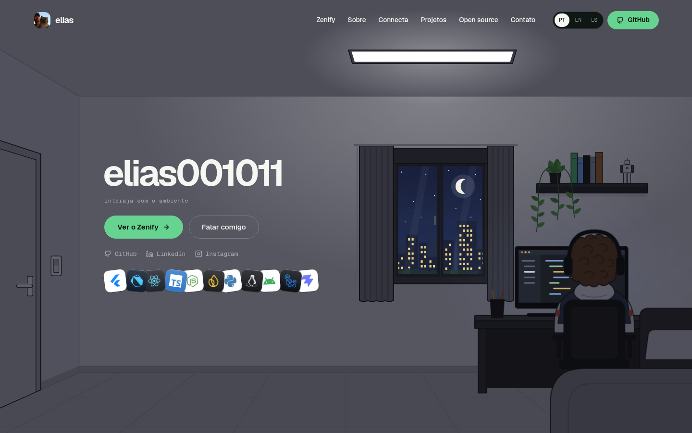

<div align="center">

<a href="https://elias001011.github.io">
  
</a>

# Elias J. R. Nunes


[](https://elias001011.github.io)
[](https://connectabr.digital)
[](https://www.linkedin.com/in/elias-nunes-b695ba406)
[](https://www.instagram.com/elias_jrnunes)
[](mailto:elias.juriatti@outlook.com)

</div>

---

Developer and co-founder at [Connecta BR Digital](https://connectabr.digital). I maintain [Zenify](https://github.com/elias001011/Zenify) and contribute to [Musify](https://github.com/gokadzev/Musify).

### Selected work

<table>
  <tr>
    <td width="50%" valign="top">
      <h3>🎧 <a href="https://github.com/elias001011/Zenify">Zenify</a></h3>
      <p>Open-source music player for Android, Linux and Windows, with Local Sync and synced lyrics.</p>
      <p>
        
        
        
        
        
      </p>
      <p><a href="https://github.com/elias001011/Zenify/releases/latest">download</a> · <a href="https://github.com/elias001011/Zenify">source</a></p>
    </td>
    <td width="50%" valign="top">
      <h3>📖 <a href="https://github.com/elias001011/sepia-reader">Sépia</a></h3>
      <p>Local-first Markdown reader and editor built with Flutter.</p>
      <p>
        
        
        
        
      </p>
      <p><a href="https://sepia-md.netlify.app">live</a> · <a href="https://github.com/elias001011/sepia-reader">source</a></p>
    </td>
  </tr>
  <tr>
    <td width="50%" valign="top">
      <h3>🎶 <a href="https://github.com/elias001011/youtube_music_explode_dart">youtube_music_explode_dart</a></h3>
      <p>Dart client for YouTube Music's InnerTube API, used by Musify.</p>
      <p>
        
        
        
      </p>
      <p><a href="https://github.com/elias001011/youtube_music_explode_dart">source</a></p>
    </td>
    <td width="50%" valign="top">
      <h3>🎓 <a href="https://github.com/elias001011/Apice">Ápice</a></h3>
      <p>AI study platform for ENEM: essay feedback, tutor and mock exams.</p>
      <p>
        
        
        
        
      </p>
      <p><a href="https://apice-ai.netlify.app">live</a> · <a href="https://github.com/elias001011/Apice">source</a></p>
    </td>
  </tr>
</table>

### Open source

**70+ merged PRs** in [Musify](https://github.com/gokadzev/Musify), including [Local Sync (#1005)](https://github.com/gokadzev/Musify/pull/1005). [See all →](https://github.com/gokadzev/Musify/pulls?q=is%3Apr+author%3Aelias001011+is%3Amerged)

<details>
  <summary><b>Toolbox</b></summary>
  <br />

<div align="center">


</div>

```txt
frontend: React, TypeScript, Vite
mobile:   Flutter, Dart
desktop:  Flutter, Linux/Windows
backend:  Netlify Functions, Node.js
```

</details>

<details>
  <summary><b>GitHub stats</b></summary>
  <br />

<div align="center">


<br /><br />


<br /><br />


</div>

</details>

---

<div align="center">
  <sub>less noise, more product.</sub>
</div>
